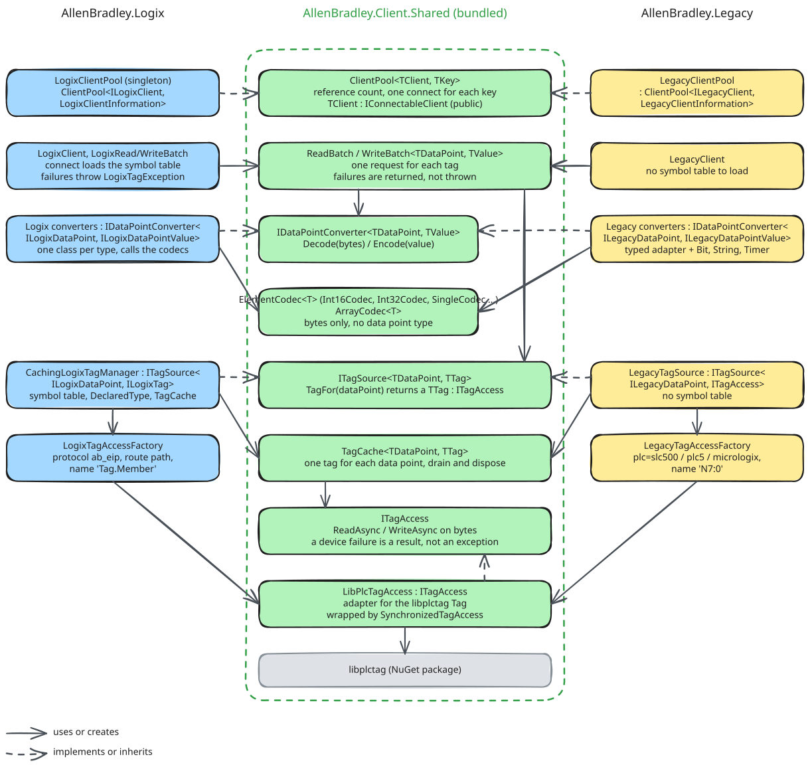

# The shared client

Both dataports reach their controllers through libplctag, and most of the code around the library does not depend on
which dataport uses it. That code is in `src/AllenBradley.Client.Shared`, so a fix to it reaches both dataports at
once. This page explains what the project holds, what stays in each dataport, and what a dataport supplies to use it.
The reasons for the split are in the
[decision record](../../AllenBradley.Logix.Documentation/ADR/2026-10-12-sharing-the-libplctag-client-code-with-legacy.md).

## What the project holds

| Part                | Types                                                         | Folder            |
|---------------------|---------------------------------------------------------------|-------------------|
| Client pool         | `ClientPool`, `IConnectableClient`, `ClientAddress`           | `Pool/`           |
| Read and write      | `ReadBatch`, `WriteBatch`                                     | `Batches/`        |
| Tags and handles    | `ITagAccess`, `LibPlcTagAccess`, `SynchronizedTagAccess`, `TagReadResult`, `TagWriteResult`, `TagCache`, `ITagSource`, `GatewayAttribute` | `Tags/` |
| Values and bytes    | `IDataPointConverter`, `DecodeException`, `ElementCodec` and one codec for each .NET type, `ArrayCodec` | `TypeConversion/` |

Every type is internal except `IConnectableClient`. The client interface of each dataport is public and extends it, and
a public interface cannot extend an internal one.

## What stays in each dataport

A type belongs in the shared project only if it names no Logix or Legacy type. Everything that depends on the data
model or on the addressing stays in the dataport:

- The data points, their values, and the converter for each data point type. A converter uses the shared codecs for
  the elementary types.
- The structured types whose layout differs between the two families: strings, timers, counters and bit arrays.
- The tag attributes that libplctag gets: the protocol, the PLC type and the tag name. Only the gateway attribute
  is shared.
- The symbol table and the configuration verification, which only Logix has.
- The exception that a failed read or write throws to the framework.

## What a dataport supplies

A dataport uses the shared parts by supplying these pieces:

1. **A client** that implements `IConnectableClient`, so that the pool can connect, disconnect and dispose it.
2. **A process-wide pool.** The dataport keeps one `ClientPool` in a static field of a class of its own, such as
   `LogixClientPool`, and tells the pool how to create a client and how to name a controller in the log.
3. **A tag source** that implements `ITagSource`. It creates the access to a handle for a data point, and keeps it in
   a `TagCache`.
4. **A converter lookup** that returns the `IDataPointConverter` for a data point.
5. **A failure policy.** `ReadBatch` and `WriteBatch` return their failures and never throw for a failed tag. The
   dataport decides what a failure means to its caller. Logix throws `LogixTagException` from `LogixReadBatch` and
   `LogixWriteBatch`.

To add an elementary type that has no codec yet, add the codec in the shared project and the converter in the
dataport.

## Packaging and tests

The project is not a package of its own. Each dataport references it, and `dotnet publish` copies its assembly into the
output of the dataport. The CI jobs and the deploy scripts publish the dataport projects, so they need no change.

`tests/AllenBradley.Client.Shared.Tests` tests the shared parts against fakes only. It has no integration tests. The
dataport test projects test the converters, the tag sources and the exceptions that their dataport adds.
